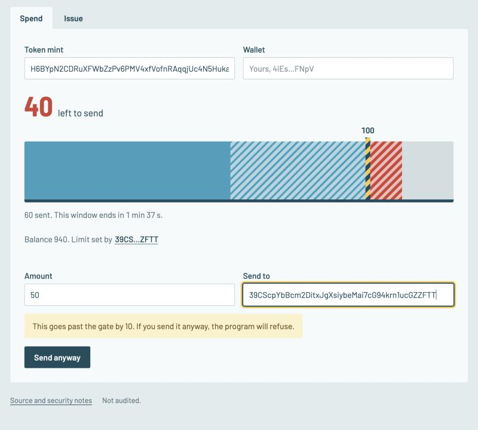

# 04-transfer-limit-hook

[](https://github.com/malharc373/solana-transfer-limit-hook/actions/workflows/ci.yml)

A **Token-2022 transfer hook** that caps how much each wallet can send per rolling time window, for example "at most 1,000 tokens per 24 hours". The cap is enforced inside every `transfer_checked` of the mint, whichever wallet, dApp or program sends it.

**Why:** spending limits for hot wallets, AI-agent wallets and treasury operators. If a key leaks, the attacker can move one window's allowance, not the whole balance.

Built with **Anchor 1.2.1**, `spl-transfer-hook-interface` 0.9 and `spl-tlv-account-resolution`. Tested through the **real Token-2022 program** in LiteSVM, exercised on devnet with a **Codama**-generated **@solana/kit** client.

| | |
|---|---|
| Program ID (devnet) | [`AdBKiZ1PFPNB2XW3SDQFZWPnjRdkocDKHhjkPLioxumC`](https://explorer.solana.com/address/AdBKiZ1PFPNB2XW3SDQFZWPnjRdkocDKHhjkPLioxumC?cluster=devnet) |
| Example `initialize` + fund | [`5gD4Xj…A2nD2`](https://explorer.solana.com/tx/5gD4XjPHu4BmaTD9KMzJcGuG7yi8FUH73Qas5DF8ypf6eEFBuBW9GsyqKS63z7T6uQ9bxq2fQAZADLiPcURA2nD2?cluster=devnet) |
| Example hooked transfer (60 of 100) | [`5gojXP…jYtr7`](https://explorer.solana.com/tx/5gojXPvEJbkvpHDEADyV9wEd4yZFLmhXww4R8cEfHQUv6g3dct5sMDdc5cpicNx5T4ke69fYoNQvdcoEoEjfYtr7?cluster=devnet) (26,960 CU) |

## The app

[`app/`](app) is a React front end for both sides. An issuer creates a token with a limit, funds wallets and changes the limit. A holder sees what is left in the current window, and what they are about to send, before signing.



- **Every send is simulated first.** A transfer the hook would refuse is stopped before the wallet asks for a signature, and no fee is paid.
- **The gauge applies the program's own window rule**, on the chain's clock instead of the browser's.
- **Extra accounts are resolved from chain** with `getTransferCheckedWithTransferHookInstructionAsync`, so the app doesn't hard-code the account list.
- **Errors are read from the logs.** The hook fails inside a Token-2022 CPI, so the failing top-level instruction is Token-2022's and an error helper that checks that instruction's program doesn't recognise it.
- **Amounts are `bigint` end to end**, and the app refuses to run on mainnet.
- Built with Vite, React, `@solana/kit`, `@solana/react`, Wallet Standard and the Codama client.

```bash
cd app && npm install && npm run dev
```

It uses public devnet. Set `VITE_RPC_URL` for another endpoint (it ends up in the bundle, so don't use a private key there). In development the app registers two throwaway wallets, so you can try both sides without an extension. They have SOL only on a local validator:

```bash
solana-test-validator --reset --bpf-program AdBKiZ1PFPNB2XW3SDQFZWPnjRdkocDKHhjkPLioxumC target/deploy/transfer_limit_hook.so
```

```bash
cd app && VITE_RPC_URL=http://127.0.0.1:8899 npm run dev
```

Tests: 14 unit tests (`npm test`), and 8 end-to-end tests that run the app's functions against that validator (`E2E_RPC=http://127.0.0.1:8899 npm test`). CI runs both.

## How it works

```
initialize(limit, window_secs)    mint authority only
  ├─ Config        PDA ["config", mint]          { authority, mint, limit, window_secs, bumps }
  └─ ExtraAccountMetaList PDA ["extra-account-metas", mint]
        tells Token-2022 to append, on every transfer:
          5  config  = ["config", mint]
          6  usage   = ["usage", mint, <source token account's owner>]   ← read from account data

open_usage(owner)                 anyone pays (the hook has no payer during a transfer)
  └─ Usage PDA ["usage", mint, owner]   { owner, window_start, used, bump }

transfer_checked (any wallet or program)
  └─ Token-2022 ──CPI──▶ transfer_hook(amount)
        1. source account must be mid-transfer (`TransferHookAccount.transferring`)
        2. issuer (config.authority) is exempt
        3. if now − window_start ≥ window_secs → new window, used = 0
        4. used + amount ≤ limit, otherwise LimitExceeded and the whole transfer reverts
```

`set_limit(limit, window_secs)` lets the authority change the limit, and the new limit applies at once.

## The delegate pitfall

In the transfer-hook interface, account 3 is the **transfer authority**. That's the owner, **or the delegate** when someone signs with an `approve`d delegate. Two common mistakes follow from this:

1. **Keying per-wallet state by account 3.** An owner can then `approve` a fresh delegate for every transfer, and each one starts with an empty allowance. Here the usage PDA's seed is read from the **source token account's data** (owner field at bytes 32..64, `Seed::AccountData`), so delegated transfers count against the owner. Test: `delegated_transfers_count_against_the_owner`.
2. **Constraining `source_token` with `token::authority = owner`.** This rejects every delegated transfer (`ConstraintTokenOwner`), so DEXes, escrows and other delegate-based flows can't move the token. Token-2022 has already verified the signer before calling the hook, so this program doesn't add that constraint.

## Security properties

| Property | Enforced by | Test that fails without it |
|---|---|---|
| The hook only runs inside a real transfer | `TransferHookAccount.transferring` check | `the_hook_cannot_be_called_directly` |
| Delegates can't reset the allowance | usage seed from the source account's owner, read from data | `delegated_transfers_count_against_the_owner` |
| The limit holds, and a failed check moves nothing | `used + amount ≤ limit`; the hook error reverts the transfer | `going_over_the_limit_fails_and_moves_nothing` |
| The allowance comes back after the window | rolling reset on `Clock::unix_timestamp` | `the_window_rolls_over` |
| Only the mint authority can configure (no front-running) | `mint.mint_authority == authority` | `only_the_mint_authority_can_initialize` |
| Only the config authority can change the limit | `has_one = authority` | `only_the_authority_can_change_the_limit_and_it_applies_at_once` |
| The issuer can distribute supply | `owner == config.authority` early return | `the_issuer_is_not_limited` |
| No usage account, no transfer | owner-program and discriminator check | `a_wallet_without_a_usage_account_cannot_send` |
| You can't spend someone else's allowance | Token-2022 resolves the extra accounts itself | `someone_elses_usage_account_is_rejected` |

**Mutation-tested:** I deleted each check in the left column (and swapped the owner seed for account 3), and confirmed that the matching test fails. The handler also re-checks the usage account's `owner` field and PDA. Those two checks are defense in depth: in a real transfer, Token-2022 already refuses any extra account that doesn't match the ExtraAccountMetaList, so no test can reach them.

## Compute units

A hooked `transfer_checked` costs about **30k CU** for the whole transaction in LiteSVM. The hook itself uses **9.1k** (7.0k for the exempt issuer), and Token-2022 uses the rest, mostly resolving the two extra PDAs. The first version used plain `seeds` + `bump` constraints, which run a `find_program_address` search on every transfer, and cost about 12k. Storing the bumps (`config.meta_list_bump`, `usage.bump`) and verifying with a single `create_program_address` makes the hook's cost constant and about 25% lower.

```bash
cargo test cu_report -- --nocapture
```

## Limitations
- **Per wallet, not per person.** Someone with several wallets gets several allowances. This is a key-compromise and operator control, not Sybil resistance.
- **Every sending wallet needs a usage account first** (`open_usage`, 57 bytes, about 0.00094 SOL of rent, which anyone can pay). Wallets without one can receive but can't send. A wallet or dApp can bundle `open_usage` into the first transfer.
- Senders' clients must append the extra accounts. Wallets that support Token-2022 transfer hooks resolve them from the ExtraAccountMetaList automatically, and `client/demo.ts` shows how to do it by hand.

## Run it

```bash
anchor build
```

```bash
cargo test
```

On each pull request, [solana-cu-guard](https://github.com/malharc373/solana-cu-guard) runs the `cu_report` test on the base commit and on the change, and fails the check if any instruction costs more.

Devnet demo: creates a hooked mint with a limit of 100 per 60 s, funds a fresh wallet, sends 60 (accepted), then tries 50 more (rejected by the hook in preflight, so no fee is paid). On devnet the accepted transfer cost 26,960 CU for the whole transaction.

```bash
cd client && npm install && npm run demo
```

Regenerate the client after changing the program:

```bash
anchor build && cd client && npm run generate
```

## What I learned
- **Account 3 isn't the owner.** It's the authority, which may be a delegate. Read the owner from the token account's data.
- **`Seed::AccountData` lets a PDA seed come from another account's bytes**, so Token-2022 resolves a per-owner PDA without the client passing the owner anywhere.
- **The hook gets no payer**, so any per-user state has to exist before the first transfer.
- **Check `transferring`.** Without it, anyone can call the hook directly and burn another wallet's allowance.
- **Bump searches add up.** Each `seeds` constraint without a stored bump runs `find_program_address` on every transfer. On a hot path like a hook, store the bump.
